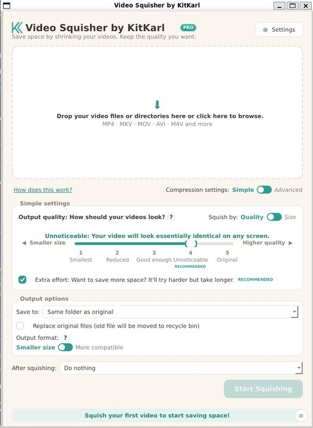

# Video Squisher by KitKarl

Drop videos in, get smaller ones back. You say how the video should look,
it finds the smallest file that still looks that way.

Every video compressor I tried wanted me to know what a CRF is, or pick a
preset out of twelve, or read a forum post first. I just wanted the file
smaller without it looking bad. So Video Squisher asks one question, in
plain english: how should the video look? Smallest, Reduced, Good
enough, Unnoticeable or Original. Then it goes and finds the strongest
compression that still passes the quality you picked. That is the whole
idea.

## The short version

- you pick a quality word, not encoder settings
- it checks its own work: every level gets test encoded and scored
  against your original before anything is kept, with the same kind of
  quality metrics streaming companies use
- smallest file that passes your bar, worked out per video
- never bigger. if the result isnt smaller it gets thrown away, and if
  it cant save at least 5% it tells you so instead of re-encoding for
  nothing
- need a file under 25 MB for an email? type the size, it finds the best
  quality that fits
- AV1 for the smallest files, or flip one switch to HEVC when the video
  has to play on older devices
- NVIDIA, Intel, AMD and Apple hardware encoding when you have it.
  FFmpeg comes bundled, theres nothing else to install
- subtitles, chapters, metadata, frame rate and portrait phone video all
  survive the squish
- watch folders (Pro): drop files into a folder, squished copies come
  out the other end
- history page with per file savings and a running total of the space
  you've freed
- your videos never leave your computer. no uploads, no accounts, no
  telemetry

## Download

- installer straight from the [releases page here](https://github.com/KitKarl-git/videosquisher/releases)
- same thing from my site: [download.kitkarl.com](https://download.kitkarl.com)

The free version does 5 videos a day, forever, no account. Pro is $29.99
once (not a subscription) and takes the daily limit off, runs the whole
queue one after another, and adds watch folders. Up to 3 machines.

**Works on:** Windows 10/11 (64 bit), macOS 13+ on Apple Silicon (signed
and notarized), Linux (AppImage or .deb). The app speaks english, chinese
and spanish.

## A few honest warnings

- it re-encodes. It is very good at keeping the look, but this is not a
  lossless tool and I wont pretend otherwise
- AV1 files need a reasonably recent device to play. That is what the
  "more compatible" HEVC switch is for
- videos that are already well compressed dont have much to give. The
  app will say so and skip, rather than burn an hour of your CPU for a
  2% saving

## Why is there no source code in here?

This repo holds the download page and the releases. The app itself is
closed source. Selling it is what pays for it, and the free tier is real
and not going anywhere. The GPL ffmpeg binaries the app bundles are
credited inside every installer, as they should be.

## More of my software

- [Image Squisher](https://kitkarl.com/imagesquisher/) - the same idea
  for photos. JPG, HEIC, RAW, screenshots, all of it
- [EdgePOP](https://github.com/KitKarl-git/EdgePop) - hover the seam
  between two monitors and see the other screen's windows
- everything else: [kitkarl.com](https://kitkarl.com)

If Video Squisher freed up some disk space for you, [a coffee is always
appreeciated](https://kitkarl.com/donate/).
